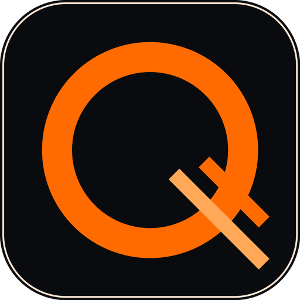

# ⚡ Qronos Code

  

  <strong>Autonomous AI Coding Agent for VS Code & Modern IDEs</strong> 
  Built and maintained by <a href="https://qronos.me">Qronos AI</a>.

  <a href="https://qronos.me">Website</a> ·
  <a href="https://qronos.me/dashboard">Dashboard</a> ·
  <a href="https://github.com/kumaryush18-cyber/qronos-code">Repository</a> ·
  <a href="https://github.com/kumaryush18-cyber/qronos-cli">Qronos CLI</a>

---

## ⚡ What is Qronos Code?

**Qronos Code** is an autonomous AI pair programmer and coding agent extension for Visual Studio Code. It generates code, plans architectural tasks, runs terminal commands, refactors codebases, and uses subagents to inspect and execute complex engineering tasks autonomously.

### Key Capabilities
- **10,000,000 Daily Tokens:** Every user gets a refreshed 10M token allowance every day at midnight UTC (`00:00 UTC`).
- **Seamless 1-Click Device Login:** Sign in using GitHub Device Code authorization directly in VS Code.
- **Direct Gateway Integration:** Connected to the Qronos AI Universal Gateway (`https://api.qronos.me/v1`).
- **Curated Frontier Model Catalog:**
  - `Claude Sonnet 5.5 [PAID]`
  - `Claude Opus 5.5 [PAID]`
  - `DeepSeek V4 Flash [FREE]`
  - `GLM 5.3 [FREE]`
  - `GPT-4o [PAID]`
- **Gravity AI Sponsor Monetization:** Contextual, revenue-generating sponsor cards beneath assistant answers.

---

## 📁 Repository Structure

- `packages/extension/` — The primary VS Code extension source, assets, and webview UI.
- `packages/gateway/` — Gateway client and API routing constants.
- `packages/core/` — Core agent tools and file systems.
- `PLAN.md` — Complete master implementation roadmap.

---

## 📄 License

MIT License — Copyright (c) 2026 Qronos AI.
