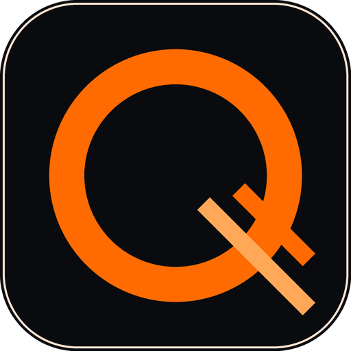

# ⚡ Qronos Code — Autonomous AI Agent for VS Code

  

  <strong>Autonomous AI coding agent in VS Code powered by Qronos AI.</strong> 
  Build, refactor, and iterate with 10M daily tokens, plan mode, autonomous terminal tools, and direct gateway integration.

  <a href="https://qronos.me">Website</a> ·
  <a href="https://qronos.me/dashboard">Dashboard</a> ·
  <a href="https://github.com/kumaryush18-cyber/qronos-code">GitHub</a> ·
  <a href="https://github.com/kumaryush18-cyber/qronos-cli">Qronos CLI</a>

---

## ⚡ Highlights

- **10,000,000 Free Daily Coding Tokens:** Every user receives 10M tokens refreshed daily at midnight UTC (`00:00 UTC`).
- **1-Click GitHub Device Flow:** Sign in straight from your editor without leaving your coding flow.
- **Qronos AI Universal Gateway:** Native access to frontier reasoning models:
  - `Claude Sonnet 5.5` [PAID]
  - `Claude Opus 5.5` [PAID]
  - `DeepSeek V4 Flash` [FREE]
  - `GLM 5.3` [FREE]
  - `GPT-4o` [PAID]
- **Autonomous Terminal Tools & Subagents:** The agent reads, writes, searches, and tests your codebase autonomously with smart error fallback.
- **Multi-Mode Architecture:** Architect mode for planning, Coder mode for execution, and Debugger mode for rapid resolution.

---

## 🚀 Quick Start

1. Install the **Qronos Code** extension.
2. Click the **⚡ Qronos Code** status bar item or open the Qronos Code sidebar.
3. Click **"Sign In with Qronos"** (or provide your `qr_...` API key).
4. Authorize on GitHub with your 8-digit device code.
5. Your **10M daily token allowance** is immediately active — start coding!

---

## 🔒 Privacy & Transparency

Qronos Code connects securely to the Qronos AI Universal Gateway (`https://api.qronos.me/v1`). Your local files remain on your machine, and file access tools require your approval unless you enable auto-approve.

---

## 📄 License

MIT License — Copyright (c) 2026 Qronos AI.
