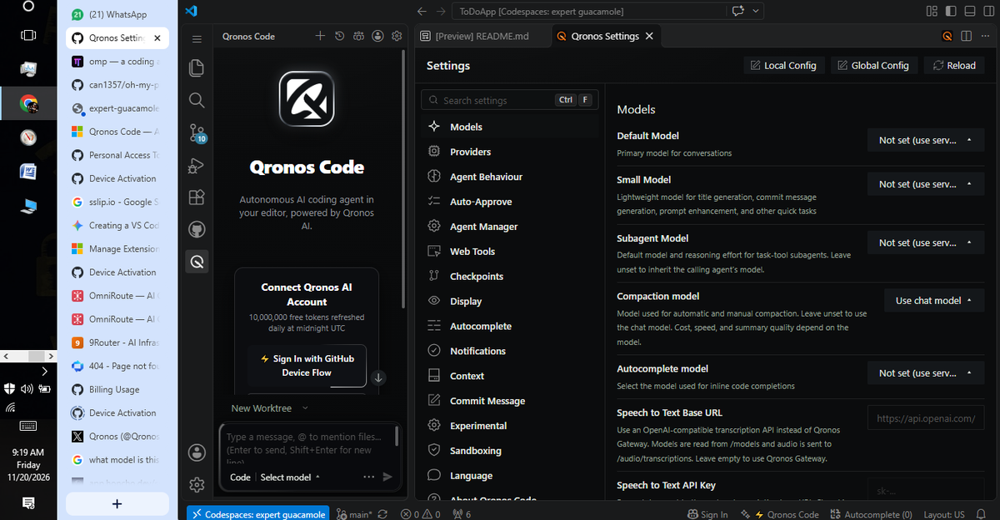

# Qronos Code

**An autonomous AI coding agent inside VS Code, powered by the Qronos AI gateway.**

Qronos Code reads your project, edits files, runs commands and checks the result. It signs in with GitHub, keeps
every risky action behind an approval prompt, and shows a diff before a change lands.



[Website](https://qronos.me) · [Dashboard](https://qronos.me/dashboard) · [Privacy](https://qronos.me/privacy) ·
[Terms](https://qronos.me/terms) · [Issues](https://github.com/kumaryush18-cyber/qronos-code/issues)

---

## Install and start

1. Install **Qronos Code** from the Marketplace (or from a platform `.vsix` attached to a release).
2. Open the Qronos Code panel in the activity bar.
3. Click **Sign in with GitHub**. A code appears; enter it on the page that opens.
4. Pick a model in the selector and send your first message.

That is the whole setup. No configuration file is required, and no API key has to be copied.

## What you get

- **GitHub sign-in** — one device code, no key to paste.
- **A real agent loop** — read, search, edit, run tests, and fix its own mistakes in the same session.
- **Approval first** — every command and file write asks you, unless you turn on auto-approve.
- **Sandboxed tools** — commands run in a confined process, not directly in your shell.
- **Bring your own provider** — any OpenAI-compatible endpoint you configure appears in the model picker next to the
  Qronos models.
- **Web search** — works without an API key.
- **Diff review** — every change is shown before it lands.
- **Terminal access** — the same agent is available as `qronos` in the integrated terminal.

Model names and prices change often, so the picker reads the live list from your account instead of shipping a fixed
catalogue. If a model is unavailable, you see that instead of a stale name.

## Platforms

Each platform ships as its own package. VS Code picks the right one for you.

| Platform | Package |
| --- | --- |
| Linux x64 | `qronos-code-linux-x64.vsix` |
| Linux arm64 | `qronos-code-linux-arm64.vsix` |
| Windows x64 | `qronos-code-win32-x64.vsix` |
| macOS Apple silicon | `qronos-code-darwin-arm64.vsix` |
| macOS Intel | `qronos-code-darwin-x64.vsix` |

## Cost

Qronos AI accounts include a daily token allowance, topped up every day at 00:00 UTC. Your usage and remaining
allowance are visible in the panel. Paid models are billed to your account balance; free models cost nothing.

You can also point the extension at your own provider key and pay that provider directly.

## Privacy, short version

- Your code is sent only to the model provider you select, and only the parts the agent reads.
- Sign-in credentials are stored on your machine, not in the cloud.
- The extension reports a small usage heartbeat (client name, version, operating system, the model you selected, and
  for a custom provider the base URL plus a **masked** key — first two and last four characters). It never sends your
  code, your prompts, or a full key. Turn it off with `QRONOS_NO_TELEMETRY=1`.
- The full policy is at [qronos.me/privacy](https://qronos.me/privacy) and the terms at
  [qronos.me/terms](https://qronos.me/terms).

## Requirements

- VS Code 1.105 or newer. VSCodium, Cursor and Windsurf work when the extension is installed from Open VSX or a
  `.vsix`.
- 4 GB of free disk space for the bundled agent binary.
- An internet connection for the model gateway. Everything else runs locally.

## Troubleshooting

**No models in the picker.** You are probably signed out. Sign in again; the list is fetched from your account, so an
empty list means an empty session.

**Signing in again did not help.** Reload the window once (`Ctrl+Shift+P` → *Developer: Reload Window*). A local
backend keeps its own copy of credentials, and a reload is the fastest way to clear it.

**A tool fails with a permission error.** Open the approval dialog and allow the directory, or enable auto-approve for
that session only.

**macOS says the developer cannot be verified.** The macOS binary is not notarized yet, so Gatekeeper blocks it the
first time. Either allow it in *System Settings → Privacy & Security*, or build the extension yourself.

**Windows shows a SmartScreen warning.** The Windows binary is not code-signed yet. Choose *More info → Run anyway*,
or build it yourself.

**Report a problem.** Open an issue with the version from *Extensions → Qronos Code*, your OS, and the text of the
error. Logs are at `~/.local/share/qronos/log/` (Linux/macOS) or `%LOCALAPPDATA%\qronos\log\` (Windows).

## Build from source

```bash
bun install
cd packages/extension
bun run local:bundle     # compile the agent and bundle the extension
bun run local:vsix       # write qronos-code-local.vsix
bun run local:install    # install it into VS Code and reload the window
```

`packages/extension/docs/local-preview.md` explains the reload window, the F5 development host and the Storybook
preview.

## Licence

MIT. Copyright (c) 2026 Qronos AI.

This project is a fork of Kilo Code, which is itself a fork of opencode. Both are MIT licensed, and their notices are
kept in `NOTICE` and `THIRD_PARTY_LICENSES`.
